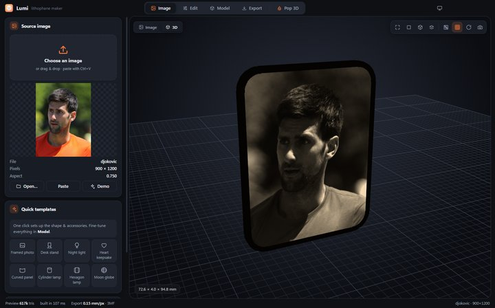
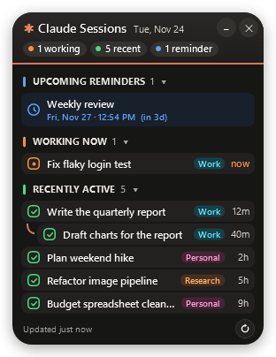
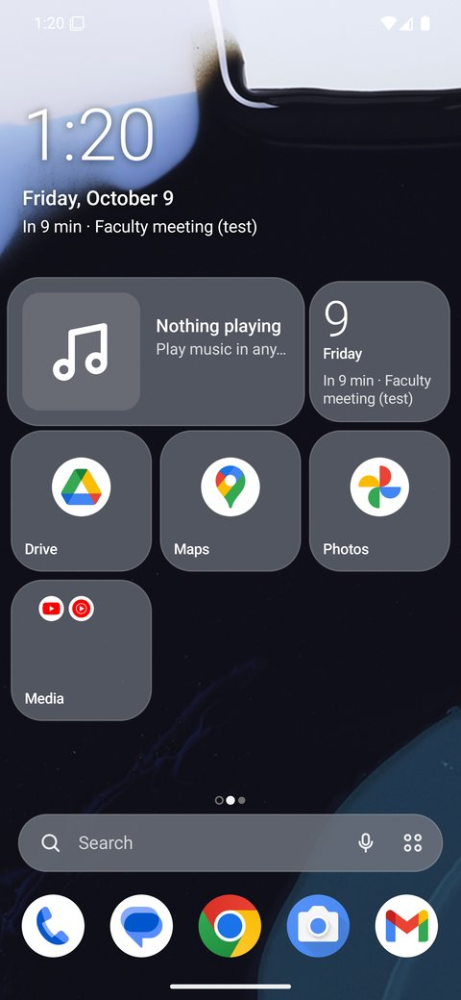
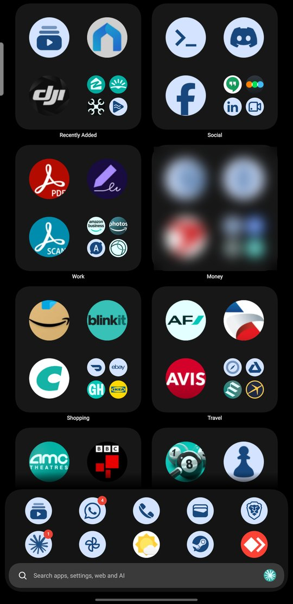
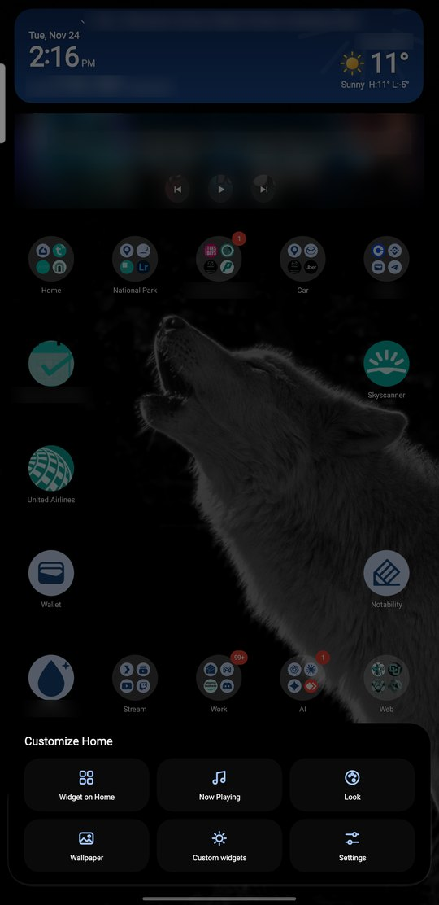

# my-apps

Release builds of my apps, with the version files they check for updates.

| App | Package | Version file | Downloads |
| --- | --- | --- | --- |
| MoreTube (Android phone) | `com.praiselab.tube` | [`moretube/version.json`](moretube/version.json) | [Releases](../../releases?q=moretube-v) |
| MoreTube TV (Android / Google TV) | `com.praiselab.tubetv` | [`moretube-tv/version.json`](moretube-tv/version.json) | [Releases](../../releases?q=moretube-tv) |
| Claude Sessions (Windows, Claude desktop app) | `session-board` (Claude mod) | [`plugin.json`](claude-sessions/mod/session-board/.claude-plugin/plugin.json) | [Install](claude-sessions/) |
| Horizon (Android phone home screen) | `com.praiselab.horizon` | source: [chahatdeep/horizon-launcher](https://github.com/chahatdeep/horizon-launcher) | [Releases](../../releases?q=horizon) |
| Lumi (Windows lithophane and 3D model maker)  | own repo | [chahatdeep/Lumi](https://github.com/chahatdeep/Lumi) | [Website](https://chahatdeep.github.io/Lumi/) |

**Claude Sessions** is a card at the top right of the Claude desktop app showing upcoming reminders, sessions working now and recently active sessions. It installs by pasting one prompt into Claude: see [`claude-sessions/`](claude-sessions/).

**Horizon** is a home screen for Android phones: clock and agenda, live tiles, folders, an app library and app search. Source: [chahatdeep/horizon-launcher](https://github.com/chahatdeep/horizon-launcher). Personal details in the screenshots are blurred.

  

**Install page:** https://chahatdeep.github.io/my-apps

Each app reads its `version.json` on launch (and from its settings); when the `versionCode` there is newer than the installed one, it offers to download the APK from the matching GitHub release and hands it to Android's installer.

## Installing for the first time

Download the latest APK from Releases and open it on the device. Android will ask once to allow installs from that source; after that, updates come from inside the app.
