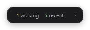

# Claude Sessions

A small card in the top right corner of the Claude desktop app. It lists your scheduled Claude tasks with their next run time, the sessions working right now, and sessions from the last 24 hours with their sidebar group. A session started from another one is indented under it.

Click a session to open it. Right-click a recent session to hide it; it reappears when you use it again.

| Dark | Light | Minimized |
| --- | --- | --- |
|  |  |  |

It uses Claude's light or dark setting (or Windows' when Claude is set to System) and changes when that does. The card moves with the Claude window, stays above Claude but not above other apps, and hides when Claude is minimized. The – button shrinks it to one line of counts, and each section folds with its arrow. If you close it, it comes back the next time a Claude session starts, when you type `/sessions`, or from the Start menu.

## Install by pasting a prompt into Claude

Needs Windows 10/11 and the Claude desktop app (Code tab). Paste this into a Claude Code session:

```text
Install "Claude Sessions" for me from https://github.com/chahatdeep/my-apps/tree/main/claude-sessions.
Download https://github.com/chahatdeep/my-apps/archive/refs/heads/main.zip into a new empty folder and extract it.
Read claude-sessions/README.md, claude-sessions/install.ps1 and the files it installs so you know what they do,
then run it with: powershell -ExecutionPolicy Bypass -File "<that folder>\my-apps-main\claude-sessions\install.ps1"
Tell me when it's done and what it changed.
```

Then open a **new** Claude session. The card fills in once a session that loads the add-on is open.

### Or install by hand

Download the repository (Code → Download ZIP), extract it, and in PowerShell run:

```powershell
powershell -ExecutionPolicy Bypass -File .\my-apps-main\claude-sessions\install.ps1
```

## What it installs

| What | Where |
| --- | --- |
| The card (a PowerShell + WPF script, and a small launcher that starts it with no console window) | `%USERPROFILE%\.claude\session-board\` (`SessionBoard.ps1`, `SessionBoard.vbs`) |
| A Claude Code mod that writes the card's data every 20 s | `%USERPROFILE%\.claude\mods\session-board\` |
| One setting so every Claude session loads that mod | `env.CLAUDE_CODE_PLUGIN_DIRS` in `%USERPROFILE%\.claude\settings.json` (a backup is saved as `settings.json.bak-claude-sessions`) |
| A Start menu shortcut | "Claude Sessions" |

How it works: in each Claude session, the mod asks Claude's own session and scheduled-task tools for the list of sessions and reminders, and writes it to `board.json` next to the card. The card reads that file. Everything stays on your computer; nothing is sent anywhere, and nothing runs as administrator.

## Uninstall

```powershell
powershell -ExecutionPolicy Bypass -File .\my-apps-main\claude-sessions\uninstall.ps1
```

It stops the card, removes both folders and the shortcut, and takes the mod back out of `settings.json`.

## Notes

- Claude only reports whether a session is running or not, so a session waiting for your answer shows under Recent, not as a separate state.
- Sessions that were already open when you installed don't load the mod. New ones do.

## License

[MIT](LICENSE). This license covers the `claude-sessions` folder only.
